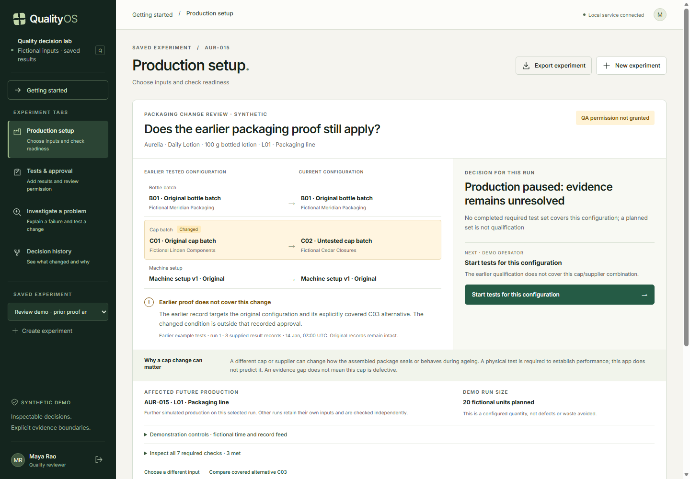

# QualityOS

### Before the next run, check that the proof still applies.

QualityOS is a manufacturing-quality decision prototype that connects packaging changes to the evidence needed to continue production. It makes one question inspectable: **do the earlier tests still cover the bottles, caps and machine setup we are about to use?**

Developed for the **L’Oréal Sustainability Challenge 2026 · Manufacturing & Plant · Option 02: Getting Quality Right First Time**. The implementation is a local, persisted application using synthetic manufacturing records.

[Run locally](#run-locally) · [Try the demonstration](qualityos/docs/DEMO_2026-11-02.md) · [Explore the architecture](qualityos/docs/OPERATIONS.md) · [Inspect validation](qualityos/docs/validation/review-remediation/summary.json)



*Actual application screen: a fictional cap-and-supplier change leaves the next run without applicable qualification evidence.*

## The problem

A packaging test passes for one bottle, cap and machine setup. A different cap or supplier is introduced. The old passing result still exists—but it may no longer support the new configuration.

That is an evidence gap, not proof that the new cap is defective. The team needs to know what changed, which earlier results still apply, what new testing is required and who can authorize the next step.

QualityOS implements that decision as a complete workflow:

```text
Packaging change → Check earlier proof → Pause affected work
                 → Collect applicable evidence → QA review → Bounded continuation
```

A change already inside an explicitly approved scope can remain supported. The system distinguishes an uncovered change, an unreliable measurement and an observed test failure instead of treating them as the same problem.

## Watch the decision change

The recommended demonstration starts with supported evidence, then lets you challenge it.

| Step | What you do | What QualityOS establishes |
|---|---|---|
| 1. Inspect the baseline | Open the original bottle/cap/setup combination | Earlier tests cover this condition; passing evidence does not automatically grant permission |
| 2. Change the caps | Select the fictional new-supplier cap batch | Old proof remains intact; the comparison shows why it does not cover the new condition |
| 3. Supply fresh tests | Enter specimen readings and a separate leak-test outcome | Measurement eligibility, test completeness and functional results are checked independently |
| 4. Resolve a failure | Record a hypothesis, an approved setup change and fresh verification | Required recovery cannot use old or incomplete proof in place of reviewed new evidence |
| 5. Authorize continuation | QA resolves the pause and grants a unit/time limit | Every production command rechecks evidence, holds and permission before saving simulated units |
| 6. Inspect history | Reopen an earlier decision or reload the experiment | Failed results, original decisions and unit-to-evidence links remain available |

The [walkthrough](qualityos/docs/DEMO_2026-11-02.md) includes both a direct passing route and a failed-test recovery route. A covered C03 alternative provides a control: a different batch need not trigger unnecessary requalification.

## Four views, one decision

The main packaging-change panel brings the next action into one place. Four workspaces provide deeper inspection of the same backend records.

| Workspace | Question it answers |
|---|---|
| **Production setup** | What changed, which proof applies and may this run continue? |
| **Tests & approval** | Are the measurements and independent functional tests sufficient for QA review? |
| **Investigate a problem** | What might explain the failure, and has the approved change been verified? |
| **Decision history** | What was known at the time, and what changed after new evidence arrived? |

## Engineering behind the decision

**Python · FastAPI · Pydantic · SQLAlchemy · SQLite · React · TypeScript · Vite**

- **Backend-enforced permission.** QA authority, active holds, evidence validity, expiry and quantity limits are checked inside the transaction that records production.
- **Safe retries and concurrent changes.** Idempotent command receipts prevent duplicate effects; revision checks reject decisions made against stale context.
- **Evidence with explicit boundaries.** Exact configuration matching and explicit joint approvals prevent a similar-looking lot from silently inheriting qualification.
- **Measurement-time validity.** A reference is checked at the time of measurement. A new calibration cannot retroactively repair an invalid reading.
- **History that survives reassessment.** Append-only events and immutable decision snapshots preserve earlier knowledge while later corrections change current implications.
- **Verified recovery and scoped containment.** Required actions need sufficient fresh evidence and QA assessment. Review of affected historical units remains separate from permission for healthy future production.

One modular backend owns the decision state. The browser submits commands and displays committed results; it cannot grant permission by changing a local approval flag. See [architecture and operations](qualityos/docs/OPERATIONS.md) for transaction, persistence, API and recovery details.

## Run locally

From this repository’s root in PowerShell, with the project dependencies already configured:

```powershell
npm start
```

Open **[http://127.0.0.1:8107/start](http://127.0.0.1:8107/start)** and choose **Inspect a packaging change** after signing in.

The first launch generates private credentials in `qualityos/var/local-credentials.json`. Use the `qa` account for the full demonstration. Operator and viewer accounts expose the role boundaries; the administrator account does not automatically have QA signing authority. Keep the credential file private.

`npm start` builds the frontend and serves it with the API on one local port. Keep the terminal open; use **Ctrl+C** to stop. Restarting retains saved experiments and history. Stop an older server before launching an updated version.

For first-time dependency installation, separate frontend development or verification commands, use the [setup guide](qualityos/README.md). The root `npm run dev` command is an alias for the complete local launch, not hot reload.

## Validation you can inspect

The latest recorded verification is dated **2 November 2026**. Results and their limits are retained alongside the code.

| Check | Recorded result | Evidence |
|---|---|---|
| Backend tests | **94 passed**, including 27 review regressions | [Raw test results](qualityos/docs/validation/review-remediation/backend.xml) |
| Frontend tests | **8 passed** | [Raw test results](qualityos/docs/validation/review-remediation/frontend.json) |
| TypeScript, production build and API contract generation | **Passed** | [Verification summary](qualityos/docs/validation/review-remediation/summary.json) |
| Real-browser workflows | **13 checks**, no captured runtime errors | [Browser report](qualityos/docs/validation/review-remediation/browser.json) |
| Original synthetic case corpus | **20/20 expected outcomes matched** | [Case-by-case results](qualityos/docs/validation/review-remediation/evaluation-v1-retained.json) |

Browser verification covers actual forms, explicit packaging changes, failed-test recovery, required QA assessment, bounded continuation, historical inspection, reload and desktop/mobile task visibility. These checks establish declared software behavior with synthetic inputs; they are not physical manufacturing trials or a blind novice usability study.

## Sustainability and validation boundary

The intended intervention is earlier than committing further product and packaging to an unsupported condition. Its potential sustainability benefit is lower unrecovered product and packaging loss—if the control closes a real operational gap. A meaningful comparison must also count extra test specimens, false holds, rework and review effort at equal accepted output.

The application does not predict leaks, control equipment or authorize commercial release. Its sample counts, test limits, dwell and measurement-error assumptions are demonstration settings. Physical performance, factory savings, industrial integration and adoption remain unvalidated. Existing QMS, MES and change-control systems provide overlapping capabilities; QualityOS is a focused prototype for evaluating this workflow, not a claim to have invented qualification or traceability.

## Explore the project

| Start here | What you will find |
|---|---|
| [Current demonstration](qualityos/docs/DEMO_2026-11-02.md) | Inputs, expected decisions, passing/failing routes and challenge cases |
| [Application setup](qualityos/README.md) | Installation, credentials, development and verification commands |
| [Architecture and operations](qualityos/docs/OPERATIONS.md) | State ownership, transactions, persistence, API and recovery |
| [Current engineering handoff](qualityos/docs/REVIEW_HANDOFF_2026-11-02.md) | Review-driven corrections, design choices and remaining limits |
| [Validation record](qualityos/docs/VALIDATION.md) | Current results and clearly separated historical checks |
| [Decision log](qualityos/docs/DECISIONS.md) | Architectural trade-offs and changes in direction |
| [Original challenge brief](https://internshala-uploads.internshala.com/common/file/cd41k3tsm5x.pdf) | Manufacturing & Plant problem statement |

Application code lives in `qualityos/backend/qualityos` and `qualityos/web/src`. Runtime databases, credentials and browser profiles belong in ignored `qualityos/var`. Earlier research and review materials are preserved locally; the current demonstration and engineering handoff describe the implemented experience. Repository setup and user-run Git instructions are in [GIT_SETUP.md](qualityos/docs/GIT_SETUP.md).
