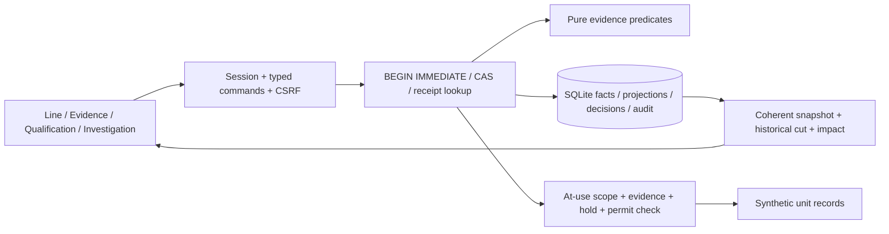

# Local architecture and operations

## Runtime and state

One FastAPI process, one SQLite store and one built React application. The default listener is `127.0.0.1:8107`; Vite development uses `127.0.0.1:5177` with the API proxy. `start.ps1` resolves all paths relative to the product, so no historical JOB path is required.



The ordered migration list in `backend/qualityos/store.py` creates schema version 1 and applies additive session-metadata migration 2 in serialized transactions. Startup reruns migration inspection safely; a newer schema is refused rather than downgraded. SQLite enables foreign keys, WAL and a five-second busy timeout. Append-only triggers protect events, decisions and audit. JSON entity projections are rebuilt semantically from event changes; record hashes detect accidental mismatches, not hostile administrator changes.

No destructive migration, reset or cleanup command is provided. Before a future schema change, stop the server and copy the complete `var` directory to a new private backup location; preserve matching database/WAL state. A live main-file-only SQLite copy is not a safe general backup. Do not commit private backups.

## Time, quantities and scenario assumptions

The server assigns one monotonic SCENARIO_UTC clock per workspace, initially 15 January 2026 at 08:00 UTC. Occurrence, availability and recorded sequence are distinct from actual system audit receipt. Initial observations occur a day earlier and only enter the seed knowledge cut at workspace creation. Historical views retain the original cut and availability. Advancing replay time does not represent physical testing, issue a heartbeat or renew a permit.

Protocol v1 is an assumed software policy: minimum three distinct synthetic specimens, application torque engineering interval within 0.90–1.10 N·m, independent leak endpoint after 24 replay hours, complete/fresh required source and complete current run identity. These are not L'Oréal qualification limits. Engineering quantities are decimal strings, at most 18 significant digits and exponent -12 to 12. Statistical expanded uncertainty is explicitly unsupported and yields unknown rather than masquerading as a hard bound.

Each observation names its study, specimen, endpoint, method, instrument and reference. Functional outcomes name the same specimen and full post-observation dwell. New references begin at the current replay clock and do not fix old observations. Reference expiry today does not invalidate a reading made while it was valid; effective retrospective revocation can invalidate current use.

The only accepted workspace mode/provenance is SYNTHETIC_DEMO/SYNTHETIC. No bench/factory import path can silently mix evidence. There is no physical-response model: the operator explicitly records declared synthetic PASS, FAIL or INCONCLUSIVE outcomes independently of torque. No model predicts a seal or makes a manufacturing causal claim.

## API and permissions

The local interactive contract is `/docs`, with machine schemas at `/openapi.json` and `/api/v1/contracts`. Versioned generated artifacts are under `docs/contracts`. Regenerate from an isolated disposable store:

```powershell
$env:PYTHONPATH = (Join-Path (Get-Location) 'backend')
.\.venv\Scripts\python.exe scripts/export_contracts.py
```

Read endpoints include session identity, workspace list, current/historical snapshot, change cursor, evaluation and export. Commands use `/api/v1/workspaces/{id}/commands/{operation}` with `expected_context_revision`, `reason`, typed `payload` and `Idempotency-Key`. The backend supplies the actor. Operation-specific models reject extra fields. All object references are validated within the named workspace.

| Role | Scope |
|---|---|
| VIEWER | Read authenticated state |
| OPERATOR | Capture context/studies/observations, investigate, propose actions, execute approved actions and request permitted simulated production |
| QUALITY_ENGINEER | Operator scope plus references/revocation, QA action approval/effectiveness, hold resolution, bounded permits and disposition |
| ADMIN | Create/configure local demonstration workspaces and run evaluation; no automatic QA signing capability |

Random local account passwords are PBKDF2-hashed in SQLite; a private initial credential file remains under ignored `var`. Session/CSRF tokens are random, stored hashed and expire after eight actual hours. Session cookies are HttpOnly/SameSite Strict; same-origin writes require CSRF and checked local Origin. This localhost prototype is not an internet-hardened or certified identity system. There is no role-picker bypass, cloud identity, arbitrary policy editor or regulated electronic signature claim.

Write transactions perform role/identity validation, idempotency lookup, CAS, domain mutation, evaluation/holds, immutable snapshots, receipt and audit together. A failed transaction creates no partial permit/unit. An identical retry returns its earlier receipt before checking a new revision; it does not renew permission. The browser retains ambiguous request identity for retry. A current ACCEPT recommendation does not bypass an active hold or create a permission.

## Recovery, exports and reproducible checks

```powershell
.\verify.ps1
$env:PYTHONPATH = (Join-Path (Get-Location) 'backend')
.\.venv\Scripts\python.exe scripts/restart_check.py
.\.venv\Scripts\python.exe scripts/benchmark.py
```

The restart script creates and terminates only its own dedicated server on 8109 and preserves its disposable store under `var/restart-checks`. Keep that port free. It checks a fresh launch, real HTTP, committed units, actual process restart and the same receipt/digest. The benchmark writes another isolated store; it never loads 10k benchmark events into a presentation workspace.

The browser scripts require an owned dedicated QA Edge process on CDP 9239. Launch it hidden with a new product-local profile; never attach to a personal session. The validated environment-specific invocation is:

```powershell
$ProductRoot = (Get-Location).Path
$BrowserProfile = Join-Path $ProductRoot 'var/edge-qa'
Start-Process -FilePath 'C:/Program Files (x86)/Microsoft/Edge/Application/msedge.exe' -WindowStyle Hidden -ArgumentList '--headless','--disable-gpu','--in-process-gpu','--no-sandbox','--no-first-run','--remote-debugging-port=9239',"--user-data-dir=$BrowserProfile",'about:blank'
$env:QUALITYOS_BROWSER_MODE = 'full'
node web/scripts/browser-check.mjs
node web/scripts/contrast-check.mjs
```

The `--no-sandbox` flag was necessary for this restricted local QA browser; do not use these flags as a general browsing setup. Close only that owned process after review. Browser artifacts are in ignored `var/browser-review` and can be regenerated. No browser upload or public hosting occurs.

Exports preserve one domain cut plus all matching event/decision records, a semantic digest and actual-time read/command/decision audit. Read audit has no effect on the domain revision. Export records are synthetic and may include fictional actor names and submitted review text; inspect before sharing. Credentials/session secrets are excluded.

## Limits that remain material

- Full historical snapshots and broad entity queries favor inspectability over high-volume industrial retention. The measured 10k-event fixture has 39 starting entities and 9,999 archival receipts with no projection change.
- The relational graph is bounded and may include historical dependencies. Edges describe recorded relationships, not causal influence. The accessible relation table carries the same queried links.
- No real operator study, physical metrology validation, factory connector, plant pilot, human-time saving, defect/waste reduction, commercial-system comparison or competition eligibility verification has occurred.
- Fresh online dependency installation is blocked here. The tested local fallback and exact lockfiles are documented; full package isolation requires a normal network-enabled setup.
- Original research, failed evidence and runtime histories are retained. Optional adapters and public deployment require separate scoped work.


## User-controlled experiments and isolated UI verification

Relational schema version 2 adds workspaces.purpose and created_by. Existing facts, decisions, audit and sessions are preserved; legacy records and known development checks are excluded from the ordinary list. GET /api/v1/workspaces?include_earlier=true exposes retained earlier sessions. POST /workspaces/{id}/organize changes only audited display/category metadata, with role and CSRF checks, leaving the quality revision and semantic fingerprint unchanged. This command cannot delete records or grant QA permission. Health reports relational version 2; domain export version 1 remains a separate contract.

CreateWorkspace.setup supports ORIGINAL/OTHER/CUSTOM bottles, ORIGINAL/UNTESTED/COVERED/CUSTOM caps, BASELINE/ALTERNATE/CUSTOM machine setup, custom names, and a finite positive custom torque setting. Custom identities cannot inherit proof from the original seed. These are fictional configurations, with no physical model. measure_batch records 1-12 distinct specimen observations in one guarded transaction and idempotent receipt. All values validate before changes commit. No operation invents an independent functional outcome.

After updating, restart the backend; refreshing the SPA alone cannot load Python changes. For this update a consistent read-only SQLite backup was made before the migration. Historical domain records are not rewritten. Legacy guided creation/API remains compatible, but the current UI creates user experiments without a guide.

Browser acceptance must not seed the real user database. Run the isolated review server in one terminal:

```powershell
Set-Location 'C:/ABYUD/HACKATHONS/LOREAL/qualityos'
$env:PYTHONPATH=Join-Path (Get-Location) 'backend'
.\.venv\Scripts\python.exe scripts/serve_review.py
```

It binds localhost 8112 and stores private data in a new var/ui-checks directory. With a dedicated product-local QA browser profile and CDP port 9239 running, run node scripts/experiment-browser-check.mjs then node scripts/experiment-contrast-check.mjs from web. The workflow refuses a session manifest pointing to the real application store. Reports/screenshots land in ignored var/experiment-review; scripts/collect_evidence.py publishes reviewed credential-free copies. Older browser scripts target the historical UI and are retained as historical artifacts; do not run them against the user's store.
